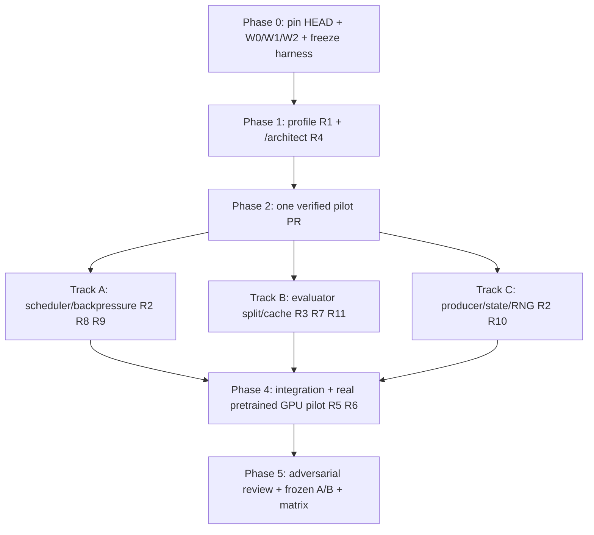

# Astrolabe Runtime：剩余缺口、实施顺序与验收规范

> **用途**：可直接放入 `docs/ASTROLABE_RUNTIME_GAP_BACKLOG.md`，作为后续 pstack 多代理工程工作的任务基准。  
> **编制日期**：2026-11-03。**状态**：待执行的 backlog，不是新一轮代码审查、GPU 实测或已完成工作的证明。  
> **来源**：上一轮运行时实现与 CPU 验证结果；开始新一轮执行时必须对齐真实 HEAD、代码与原始 evidence。

## 0. 结论与目标

当前已经建立模型/worker 生命周期、请求身份、部分 CPU/GPU 工作划分、资源准入、guardian、实验性自适应调度和验证入口；**未证明生产级 GPU 提速**。当前最优先要完成的不是继续扩张 registry，而是验证并优化完整的 **producer → prepare → GPU execute → finalize/scoring → ordered commit** 数据流。

成功的定义：在**相同科学协议、相同计算工作量定义、相同质量/失败率门槛与明确资源预算**下，真实 pretrained 模型工作流的有效吞吐量可重复地提升；GPU 等待时间可按原因归因；模型驻留、失败恢复、缓存和轨迹状态在长运行与并发条件下正确。

原则：**先测量，后找因，再改动，再复验；性能负结果必须保存；单轮只保留具有可复现收益的改变。** 利用率不是优化目标，`successful completed evaluations / wall-clock` 和 `accepted scientifically valid progress / GPU-hour` 才是核心指标；报告两个口径时不能混淆。

## 1. 已知基线与证据强度

| 项目 | 截至 2026-11-03 的已知事实 | 证据性质 |
|---|---|---|
| 代码分支 | `feat/runtime-resource-lifecycle-20261103`，HEAD `d66ee714f2e755948534f95d9d125287ce8dbd91`；实施父提交 `834402daade9f62e9dec0b08041dade163a89369` | 上一轮交付；本轮应重新核对远端 |
| 输入方案基准 | `b537b8a81ff0738922e80a997ffeb9700cdafe09` | 固定参考，不代表现时 main |
| 模型 registry | 14 evaluator keys（13 个 family）、20 mutator keys | 已审查 registry，**不是** 34 个真实 GPU backend 已认证 |
| 测试 | snapshot04：403 passed、1 fixture failure、1 skipped；随后 snapshot05：21 passed，修复 fixture；snapshot06：148 passed、0 skipped | **不同批次**；不能写成“单次全套均通过” |
| CPU 科学流程 | Dummy / MCMC 旧直连、常驻串行、常驻自适应三模式：最终 27/27 轨迹完成 | 真实 CPU 工作流，不等于真实 GPU pretrained 认证 |
| CPU 中位耗时 | direct **9.691 s**；resident serial **32.418 s**；resident adaptive **33.455 s** | **负性能结果**：常驻模式约慢 3.35× / 3.45×；需要归因 |
| GPU | 尚无完成的 pretrained 真实 GPU 并发/加速认证；同卡 forward 默认上限 1 | **未知**，不能声称已经达到吞吐目标 |
| 分支与交付 | `261b240` 另一条工作线未合并；已生成 bundle、patch 和独立 review worktree | 先处理 merge-base / ownership，禁止覆盖其他工作 |

**首选原始证据**（实际路径须核对）：

- `docs/runtime_implementation_report.md`
- `docs/runtime_execution_guide.md`
- `docs/evaluator_lifecycle_matrix.md`、`docs/mutator_lifecycle_matrix.md`
- `evidence/runtime-20261103/snapshot06-command.json`
- `evidence/runtime-20261103/cpu-benchmark-02-command.json`
- `evidence/runtime-20261103/cpu-three-mode-02/report.json`
- `evidence/runtime-20261103/implementation-inventory.json`

## 2. 工作项（按因果依赖而不是文件数量排序）

| ID | 优先级 | 缺口 / 目标 | 可验证交付 | 依赖 |
|---|---|---|---|---|
| R0 | **P0** | 冻结真实基线、代表性 workload、资源预算和正确性 gate | 可复现命令、环境指纹、原始 traces、成功/错误/工作量计数 | 无 |
| R1 | **P0** | 定位 resident CPU 回退（9.69→32.42/33.45 s） | 负载归因、最小修复或按成本选择 direct fallback 的决策与对照数据 | R0 |
| R2 | **P0** | 科学上合法的 Producer–Consumer 异步流水线 | 独立候选可同时处于不同阶段；有界 queue、背压、取消、唯一提交；真实 E2E trace | R0；R4 的接口设计 |
| R3 | **P0** | 真实后端 `prepare / GPU execute / finalize` 边界 | 模型调用图、数据 owner、CPU/GPU 计时、同步/传输次数；至少一个 GPU pilot 端到端通过 | R0、R4 |
| R4 | **P0** | 定义跨模块 ownership、任务/结果 identity、科学状态规则 | caller-first API sketch、状态转移、2 个独立架构备选、选型 ADR | R0 |
| R5 | **P0** | 建立首个 pretrained GPU backend 的准确性、驻留与稳态吞吐认证 | 冷/热加载、数值/决策一致性、连续请求、重启/OOM、资源曲线与对照 | R0、R3（可先测原版） |
| R6 | **P1** | GPU concurrency / dynamic microbatching 的后端专属档位 | 同卡 1/2/N、batch 候选比较；显存和有效吞吐随负载变化；不获益时关闭 | R5 |
| R7 | **P1** | 增量预处理与严格缓存失效 | 变更 1/若干 residue 时的 dependency graph、cache hit 与 stale-cache negative control | R3、R5 |
| R8 | **P1** | 动态资源调度与多 GPU 策略 | 按 GPU/CPU/RAM/VRAM 与负载进行 admission、fairness、backpressure；资源不能超卖 | R2、R5 |
| R9 | **P1** | 故障与恢复语义（daemon crash、timeout、OOM、late reply） | fault injection、OutcomeUnknown、不重复计算/提交、不泄漏租约或僵尸子进程 | R2、R4 |
| R10 | **P1** | 科学正确性与可复现性门禁 | 相同 seed/配置下的候选、评分、接受决策、stage transition、checkpoint 对照 | R2–R9 |
| R11 | **P1** | 完整后端与 mutator 生命周期覆盖 | 按**实际 registry key + 版本 + 配置**矩阵出证据：已认证/仅代码/未测试/不支持 | R5，随阶段递增 |
| R12 | **P2** | 新型号/新版本、异构多 GPU 扩展与部署自动化 | 独立 ADR + 工程验收；不阻塞 P0 / P1 | R5–R11 |

### R0：正确性与性能测量底座（首先完成）

建立最少三类工作负载：**W0** CPU Dummy/MCMC（复现已知负结果），**W1** 代表性 pretrained evaluator + 实际 mutator 的单轨迹工作流，**W2** 科学上相互独立的多 repeats / candidates，验证有意义的并发潜力。必要时增加 **W3** 混合长度、复杂约束、target 复用/序列微扰。

数据必须包括：`workload_hash`、commit、机器/GPU UUID、driver、CUDA、容器/conda、模型权重 checksum、config hash、seed、预算、请求数、实际 eval 次数、成功数、失败数、重试数、warm/cold、显存峰值、RAM 峰值、GPU idle reason，以及各阶段的 wall-time/span。对模型首次加载和稳态分开计数。

采用**同一脚本、同一配置、同一工作量**比较 direct / resident serial / resident adaptive；至少 5 组交错 A/B（如 ABBA）重复，报告 median、范围及不确定性。Profiler 与正式计时分开。没有模型/设备授权则记录 `BLOCKED`，不能用 dummy 代替 GPU 结论。

### R1：resident CPU 负性能的归因与修复

逐段测 `spawn/import/handshake`、checkpoint load、config parse、IPC serialization、queue wait、context switch、lock wait、CPU prepare、model forward、postprocess、cleanup。区分**冷启动**与**长稳态**，计算 break-even 候选数。针对 root cause 做一个可证伪修复；如果 CPU-only 轻任务天然不适合常驻，则配置直连 fast path，并用 W0 验证自动路由没有显著回退。

**退出标准**：找到主导开销的测量证据，并证明修复/fast path 的改善超过运行噪声；否则保留负结果，勿声称修复。

### R2 + R4：Producer–Consumer 的必要科学边界

**最关键的不可违反约束**：单条自适应 MCMC 轨迹的后续 proposal 往往依赖上一轮 evaluation / acceptance。不能把这种依赖关系假装独立而提前生成未来步骤。并发来源必须明确属于：

- 独立 trajectories/repeats、独立 branch；或
- 同一已固定 parent 下**科学协议明确允许**的多 proposals / batched evaluation，并且 acceptance 与 RNG 消耗规则有可证明的等价语义。

状态 owner 只在 `ordered commit` 更新；worker 只能消费不可变请求快照。每条任务包含 `{trajectory, stage_generation, parent_state_version, candidate_id, proposal_rng_id, model/config/constraint fingerprint, work_id}`。所有 completion 经过版本校验，拒绝 stale reply；重复通知和 retry 不产生双重评分/accept。阶段切换为事务边界，不让旧 stage 的结果进入新 stage。mutator 作为 producer 不得通过持有 evaluator lease、全局锁或同步 callback 阻塞 GPU。小 mutator 如与 evaluator 同卡共存，必须在显存和竞争实验通过后才启用。

**退出标准**：W2 中 CPU 工作与 GPU 前向有可见重叠；W1 严格依赖 case 正确地保持串行；cancel/retry/stage race 注入通过；同 seed 科学行为按协议保持。

### R3 + R7：执行阶段拆分与增量缓存

统一术语：`prepare_host(request, reusable_artifacts) -> prepared`、`execute_device(prepared, resident_model) -> device_result`、`finalize_host(device_result) -> scores/structures`。这是设计**目标**，不是强制所有模型同样的函数签名；跨进程持有 GPU Tensor、device synchronization、D2H/H2D 和模型内部无法拆分的 graph 需要逐个实际审查。

按以下依赖拆缓存：target/template/MSA 等 target 级特征；不变的 geometry/constraint；变化的 sequence token/embedding；sampling seed、recycle、diffusion schedule 等请求级状态。**cache key 必须包含所有影响计算结果的依赖**，不能凭“仅改一个残基”复用本应重新计算的特征。每一项缓存须有 altered-input negative control 和同输入 positive reuse 证明，并在科研正确性 gate 下测收益。

**退出标准**：至少首个 pretrained pilot 有精确阶段边界和经证明有效的可复用数据；报告 cache-hit 相对冷/热 baseline 的净效果；不适用的 backend 明确标注。

### R5 / R6 / R11：逐实际变体认证，不以名字充数

第一轮选择**一个**权重、依赖和配置已确认且成本可控的 evaluator 作为 pilot。认证矩阵至少包含：registry key、真实项目版本/commit、weights hash、config/constraints、设备/precision、创建/首次/复用/释放、相同输入的数值/结构结果、不同输入隔离、CPU/GPU 时间线、单卡串行/并发/合批结果、峰值显存、崩溃恢复。

后续按实际可运行条件扩展到 AF2、AF3、Protenix 具体版本（例如 v0.5/2 需核对真实依赖）、ESMFold/ESMFold2、OpenDDE、Mol-1、Chai-1、Boltz **实际版本**以及其他现有 registry。registry 中有 `boltz` **不等于** 已验证 Boltz2；别名也不等于额外 family。版本新增与 runtime 优化分成不同验收项目。

同卡并发默认 `1` 是合理的安全基线：每个 backend 通过显存、科学结果、吞吐和调度干扰试验后才能扩大。允许 adaptive 收缩到 1；**不能把 GPU busy 当成功判据**。

### R8 + R9：稳态运维与异常安全

必须测试：多 evaluator/多个 mutator 共卡时 RAM/VRAM admission；worker crash、daemon orphan、PID reuse、GPU OOM/fragmentation、跨进程 timeout、cancel during forward、late result、cache invalidation、restart/reload、资源租约释放和多 client fairness。故障路径记录 `OutcomeUnknown` 语义，不默认把未确认失败当成“模型没运行”，也不偷偷重复提交同一科学动作。

### R10：科研语义的 gate

在固定代码、模型配置、seed、输入和协议下，比较 direct 与 resident/adaptive 的 proposal 序列、每次评分、决策、结构文件 hash/数值容差、stage transition 和最终 checkpoint。对本身非确定性的 GPU 算法，定义**可接受的数值/统计对照**，而非要求本来不保证的逐比特一致。所有不一致必须能追到调度、缓存、随机数或模型运行差异；科学协议改变只能作为单独实验，不能混进 runtime 性能 PR。

## 3. 执行阶段与依赖链

建议一个**可观测的 pilot**先走完发现、修复、验证、code review、集成全链路，再三路并发扩展。不同 worktrees 做隔离；每个文件只有一个 writer；主代理拥有设计取舍、调度、集成、证据判断，三子代理为不同代码 owner 并交叉复审；不要让三个代理同时重写核心 `run.py`。

## 4. 性能指标、止损线和完成门槛

| 指标 | 定义 / 必须报告 | 初始判定准则（可按业务预算正式冻结） |
|---|---|---|
| 主要吞吐 | `successful scientifically valid evaluations / total wall-clock`，包含 warm/cold 区分 | 与同预算、同配置的最优已知基线相比提高，且超过噪声；建议初始工程目标 **≥20%**，不是当前已达成事实 |
| 科学进展 | accepted candidates、轨迹最终评分/质量与协议一致性 | 不得为了速度降低比较的计算工作量或偷改 acceptance |
| GPU 供给 | GPU 可用时 `ready queue empty`、`queue waiting`、`CPU waiting`、`VRAM admission` 等 idle reason 分解 | **可解释的** GPU 空闲；不能保证单条依赖轨迹 GPU 100% 满载 |
| 稳态性能 | p50 / p95 eval latency、req/s、work/s、同卡 in-flight | 报 median + 范围 + 误差/完成数，不能单测一轮 |
| 内存与安全 | RSS/VRAM peak、OOM、daemon 重启/漏资源、错误提交 | 零科学错误提交 / 无不可控显存超卖；限制由配置确定 |
| CPU 回退 | W0 direct vs resident/auto，冷/稳态 break-even | 修复主因或自动选 direct；不能把 3.3× CPU 退化藏起来 |
| 决策成本 | 每个优化 attempt 的 GPU-hour、收益/失败率、返工 | 高成本前先低成本原型；每个 attempt **keep 或 revert** |

**冻结 benchmark 后**，至少 5 次交错比较、保存原始数据、分开 profiler。仅当超过噪声且 correctness gate 全绿才 `keep`；否则 `revert`。若缺 GPU / weights / config / 授权预算，则 GPU 认证标 `BLOCKED`，完成 CPU 与代码可验证部分，不虚构性能结论。

> `≥20%` 是建议的工程优化门槛，**不是用户提供的 SLA**，正式执行应在读到真实资源和 workload 后冻结，不能后验修改以宣称成功。

## 5. 交付物与完成定义（Definition of Done）

输出在目标仓库（或明示隔离目录）中：

1. `docs/runtime_architecture_decision.md`：当前代码行为、至少两种真正不同的方案、caller-first 数据形状与状态 owner、取舍和 rejected alternatives。
2. `benchmarks/runtime/workloads/` + `benchmarks/runtime/run_*.py`：不依赖人工修改的 W0/W1/W2 复现入口；记录环境、seed、工作量、原始 traces、错误数。
3. `evidence/runtime-next/`：baseline、每轮实验、科学等价性、fault-injection、GPU 认证矩阵及留存的性能负结果。
4. `evidence/runtime-next/decision.tsv`：`attempt_id | hypothesis | baseline | patch_sha | result | errors | work_count | cost | keep/revert | reason`。
5. 可审查的 commits / PRs，独立 worker worktrees、owner、reviewer、准确 HEAD SHA、回归命令；最终 HEAD 重跑验证。
6. `docs/runtime_backend_certification.md`：按真实 backend + variant + scientific config 列示 VERIFIED / PARTIAL / BLOCKED / UNSUPPORTED，并附命令/数据。
7. `docs/runtime_final_report.md`：主要结论、direct/resident/adaptive 对照、资源成本、剩余缺口、未完成或无法认证项。

完成不能只看“所有工作项都有代码”：至少首个真实 pretrained GPU pilot 必须通过科学 gate 和稳定性 gate，且**在同等可比较条件下取得可重复的端到端有效吞吐提升**。若经过可复现证据发现算法依赖/供给或环境限制导致无有效加速，应坦诚报告该结论和下一步选择，不作虚假通过。

## 6. 禁止事项与高风险提醒

- 不得修改序列 proposal、scoring、acceptance、约束或 stage semantics 来换取 runtime 速度。
- 不得把 MCMC 的因果依赖当成任意可并行任务；不为填满 GPU 产生科学上不使用的无效工作。
- 不得因为模型有 registry key 就声称经过真实预训练权重测试；不同版本不混算。
- 不得以 dummy CPU smoke、mock device、静态单测代替真实 pretrained GPU 认证。
- 不得让模型推理、计分与提交在多个 writer 间共享可变全局状态；避免 silent state leak。
- 不得未经确认占用共享 GPU、大量 GPU-hours、修改生产分支或 merge；不覆盖 `261b240` 等其他工作线。
- 不得无依据地引入巨大 scheduler 框架、调高并发或无限扩展缓存；若小修复足够，优先小修复。
- pstack host-adapted 插件提供方法文本，不代表自动拥有 Cursor `Task` / `orch` / 模型配置 / TLA+ 可执行程序；必须使用实际可用工具并如实报告。
