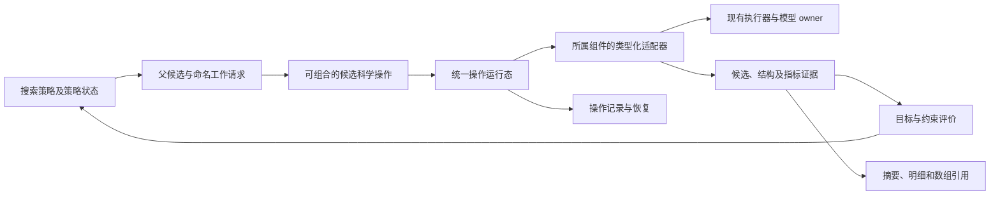

# 统一、可组合的科学计算框架

本文记录 2026-10-31 的架构选择和迁移契约。用户列举的搜索、模型、
多 state 设计和打分方式是验收例子，不是范围清单。范围覆盖现有全部
能力，以及它们之间的状态、配置、执行、输出和恢复契约。

状态：统一数据、操作、测量/采样与搜索控制内核已实现；默认、独立分支、
collection 和 paper 入口的控制循环已收敛至同一驱动。全部科学能力、
持久资源及 GPU/provider 的适配与资格验证仍有后续工作。当前可运行边界见
[实现说明](06_unified_framework_implementation.md)。
配套文件：[类型与接口](04_unified_framework_sketch.py)、
[使用方式与恢复示例](05_unified_framework_usage.md)。

## 使用方式先行

保留 `Astrolabe(config).run()` 和现有命令入口。任务配置描述分子系统、
选用组件、操作组合、搜索策略、目标和输出视图。只解析选中组件的
参数；原有 Hydra 配置通过边界转译进入相同运行机制。

程序化组合使用类型化的科学操作。搜索器选择父候选、扩展方式、保留
规则与停止条件；候选操作组合负责初始化、设计、预测、变换和评价。
同一组合可由单轨迹、beam、population 或其他搜索策略调用。
模型内部 recycling 和外层操作循环是两个不同概念。

新增科学任务应能由组件及配置组合表达。新增算法在它所属的扩展面
注册；共享搜索循环不增加分子类型、任务名或模型名分支。真实的分子
类型、原生特征、化学约束和模型计算差异由类型与适配器保留。

## 当前代码的实际关系

- `core/protomer_config_parser.py` 的 `Segment` 同时保存序列、PTM、固定
  属性、概率、逐位点分数和 pending mutation。别名复用同一个 Python
  对象；`SegmentManager` 按对象身份去重。`Protomer` 是有序引用与 slice。
- oligomer 当前是字符串；`AAB` 的物理链 A/B 引用 protomer A，物理链 C
  引用 protomer B。共享序列不意味着这些物理位置具有相同结构观测。
- `Evaluator.evaluate` 分准备、计算和结果适配，返回 `StandardScores`。
  `Mutator.mutate` 经准备、计算、输出处理，向共享 Segment 写入概率和提案。
- 初始盘点时，`run.py`、专属 beam 和实验性 candidate batch 各自管理搜索。
  默认 `run.py` 现已删除外层搜索循环，由公共 coordinator 驱动有界 root/advance；
  其余分支与 collection 入口也已迁入通用策略；独立 dispatch 和专属控制循环
  已退役，科学 worker、适配器及输出转换保留。实际验收见 06。
- `StandardScores` 混合结构路径、confidence、逐 protomer/chain-pair
  数组和 contributions。其 clone 是浅复制，hash 是对象身份。
- 部分逐 protomer 数组已经丢失来源 assembly、copy 和 sample 标识。
  兼容层只能明确标记已有聚合，不能伪造原始 occurrence 数据。
- `LossEngine` 包含测量调用、表达式、聚合和部分缓存；一些序列 loss
  读取全局 protomer。evaluation 对象身份不是完整依赖描述。
- `run_config_lifecycle.build_persisted_run_config` 已裁剪未启用配置。
  应扩展该职责；不另造一套配置或来源管理机制。

## 核心对象与唯一职责

| 对象 | 统一语义 |
| --- | --- |
| System | 共享变量定义、分子种类、组装、物理 occurrence、残基/原子映射、约束 |
| Candidate | 对全部共享序列及化学变量的不可变赋值；内容身份与谱系分开 |
| Proposal | 父候选、working base、新候选、变更和使用的证据 |
| Artifact / Evidence | 某候选在某分子 state、sample 和协议下产生的观测及来源 |
| Measurement / Selection | 带定义、单位、命名轴和对象的观测；选择与归约不破坏原始数据 |
| Assessment | 在明确 objective/history 版本下的聚合值与 gates |
| Trial | 可组合的候选科学操作，提供根候选评价、扩展和能力需求 |
| SearchPolicy | 父候选、population/frontier、选择、stage 和停止策略 |
| Runtime | 命名操作的依赖、缓存、记账、执行、持久化和恢复 |

Candidate 必须包含 PTM、化学状态及 System 身份，不能仅以某条 sequence
字符串代表完整候选。共享变量拥有一个赋值，多个 occurrence 各自保留
结构上下文。分支与兄弟候选之间没有共同的可写科学状态。

## 数据流

公共操作返回它自身的类型：选择器返回 Selection，预测返回 Evidence，
结构处理返回 Artifact，提案返回 Proposal 或有明确语义的分布。
不采用一个 `run(dict) -> dict` 协议吞掉这些差异。

## 打分、分布和约束

所有来源的指标均保留 quantity/definition、producer、单位、candidate、
state、artifact、sample、命名轴和依赖。命名轴区分有序 pair 的左右两端，
以及 state/copy/sample 等维度。缺失是显式状态，不用零值代替。

查询共享选择与归约规则：区域 SASA 是在明确结构上下文中选择后归约；
切出区域重新计算是另一项结构操作与测量。PAE 的行列分别选择，不自动
对称化。来自不同 state、copy 或模型的值只在显式策略下聚合。

raw measurement 与 objective transform、权重、gate 和历史相关决策
分开。原有 loss 和逐残基函数先保留科学定义，通过适配器逐步迁移。
`ScoreContribution` 与预测、mutator、后处理指标使用同一读取边界；
CSV 扁平化只是输出视图。

分布声明字母表、位点、条件、样本、值的语义以及已应用操作。兼容的
独立分布共享 bias、mask、temperature、采样实现，并在正确解码边界
执行一次。自回归、联合采样和直接提案保留原本语义。

结构并置、grouped inference、概率 mixture、log-probability fusion
是独立的可组合操作。融合概率后保留下来的 primary log_probs 必须
注明只属于 primary，不能称作融合分布的原始 logits。原有科学协议
通过明确的兼容策略保留，新组合不能无声继承这种歧义。

约束意图和实际执行机制分开。能力需求由开放的、类型化组件声明，
不把目前举例的约束种类固化成核心闭合枚举。必要的原生约束无法执行
时，在相应计算前报错；不改成另一种作用方式。已知能力兼容性在模型
加载前检查，依赖动态结果的请求内容在调用边界再次检查。

梯度计算需要真实后端适配器及明确参数空间、tensor 和 owner 生命周期。
RGI/HalluDesign 的未合并或不存在实现不会被宣称已支持。其操作可通过
相同扩展契约接入，不从普通落盘数组推断可微性。

## mutation 与失效

| 变化 | 处理 |
| --- | --- |
| 共享变量改变 | 新建 Candidate；影响所有引用它的组装输入 |
| 受影响组装的新候选 | 重新预测并计算依赖它的新观测；非突变残基也不能假定结构指标不变 |
| 未变化组装或输入投影 | 仅在实际 query/features/MSA/templates/conditioning/model/sample 等依赖一致时复用 |
| 旧候选结果 | 保留为历史或明确的 base/reference evidence，不标成新候选观测 |
| 仅 objective 权重等改变 | 保留兼容测量，更新相关归约、gate、历史比较及 decision |
| 精修、对接等改变结构 | 新 Artifact 与映射/来源；原模型置信度仍属于原预测 |
| 固定来源资源与模型权重 | 不因候选 mutation 失效 |
| 无法确定旧适配器的依赖 | 禁用其结果复用，不猜测有效性 |

堆叠 mutator 可使用旧结构指导新 working candidate；EvidenceUse 必须
同时指明 evaluated candidate 与 working candidate。保留这一科学策略，
不强行增加中间预测，也不把旧分数重新标记成新分数。

## 执行与恢复

同一个 Runtime 管理有稳定名称和输入身份的操作边界，内部处理
prepare、能力检查、依赖、预算 reservation、issued、结果及终态。
Trial 作者调用科学操作，无需各自实现预算和恢复循环。

操作记录区分 reserved、issued、completed、failed、unknown。控制流程
恢复时可重新进入 Trial：已完成操作读取持久化的类型化结果及随机状态
记录；已 issued 而结果未知的操作先 reconcile，不能自动重发。
因此跨多轮 Trial 的恢复不要求序列化任意 Python closure。

模型 owner、PipelineExecutor、设备完成信号、RNG 与 no-replay 契约
继续由已有执行设施承担。旧全局可写组件在隔离的 worker 所有权内适配，
多个 RuntimeContext 包装器本身不构成候选隔离。

## 完整能力迁移与退役

| 现有能力 | 迁移与退役边界 |
| --- | --- |
| 分子解析与初始化 | 保留解析、来源、固定/PTM/化学语义；初始化通过所属注册入口产生候选/结构 |
| 结构处理与 pre/post hooks | 统一为有类型的输入或 Artifact 操作，保留条件、候选 bank 与来源 |
| selector 与 conditioning | 统一选择/轴和能力声明；保留原生特征构造，移除散落任务分支 |
| evaluator 与模型执行 | 全注册项通过输入、证据和能力边界适配；保留模型数学与 owner |
| mutator 与采样 | 全注册项适配直接/联合提案或明确分布；迁移后删除共享概率/分数写入机制 |
| loss 与逐残基指标 | 共用测量读取、选择与目标评价；删除同指标的重复入口与不完整缓存 |
| 单轨迹、beam、population、stage、collection | 同一 coordinator 配合策略；迁移调用方后删除对应专属控制循环 |
| 配置、输出、posthoc 与 replay | 统一有效配置、候选/证据记录和视图；保留旧格式边界转译与读者验收 |
| 安装、运行环境、资源与 provider | 由选中组件需求关联现有目录和执行设施，不另复制清单 |

覆盖检查从真实注册或分发入口枚举，而不是另写同名列表。尚无注册入口
的能力在原所属模块补齐；新增组件不要求修改搜索内核。旧命令和配置
可作为兼容转译入口，不能永久保留第二份执行机制。

历史 recipe 的长度、类型、布局、指标、seed、样本、预算、去重、排序、
校准和 gate 等科学约束保留在可组合的配方、策略或计算中。通用内核
不认识 RNA beam、protein beam 或某个科学任务。

## 架构选择与取舍

两份独立 Sol 方案分别考察了声明式 typed recipe compiler 和直接类型化
组合；独立交叉评审与主助手均选择后者作为基础。

采用直接组合的自然结果类型和较小调用面，合入另一方案的显式 Proposal、
实际依赖清单、能力预检与持久化操作记录。配置仍是类型化组件的工厂层，
不再引入强制的公共 AST/DAG 语言或第二套调度器。

接受依赖、轴和来源元数据的成本，换取正确复用；接受旧组件的临时进程
隔离，换取科学行为连续；接受 Python 组合流程不直接序列化，以稳定操作
记录和明确 policy codec 支撑恢复。不会同时发布两套主创作接口。

## 实现顺序与验收

1. 建立共享变量、Candidate、occurrence、Proposal 与证据边界。验证
   alias、重复位点、多链副本、化学/PTM、父及兄弟候选不变。
2. 实现有类型的命名操作、所属组件描述和读取视图。覆盖全部注册能力，
   验证新增组件不改内核、pair 轴、缺失值、重复采样操作和不支持能力。
3. 实现统一 coordinator、策略与操作记录，验证根候选评价、多父候选、
   操作循环、预算、失败、两轮中断恢复及 unknown 不重发。
4. 迁移现有主路径与科学适配器；保留 stage/acceptance、种子和样本语义。
   迁移各 beam、collection 入口并删除重复控制机制。
5. 完成选中配置、默认摘要、明细/数组引用与旧格式读者验收；核对全仓
   调用关系，删除已无调用者的过渡实现。

每一步的 canary 用来排序实现，不缩减整个框架的迁移范围。CPU 功能
验证、真实模型数值验证和 GPU 吞吐是不同证据，不互相替代。
